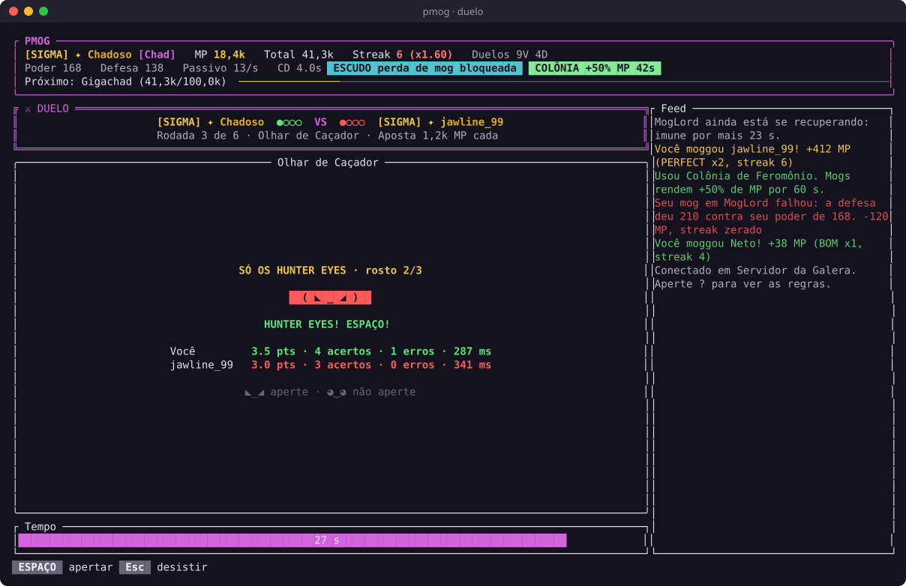
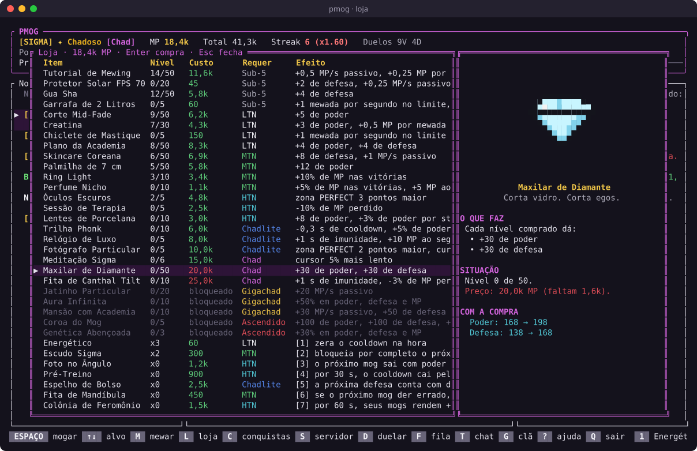
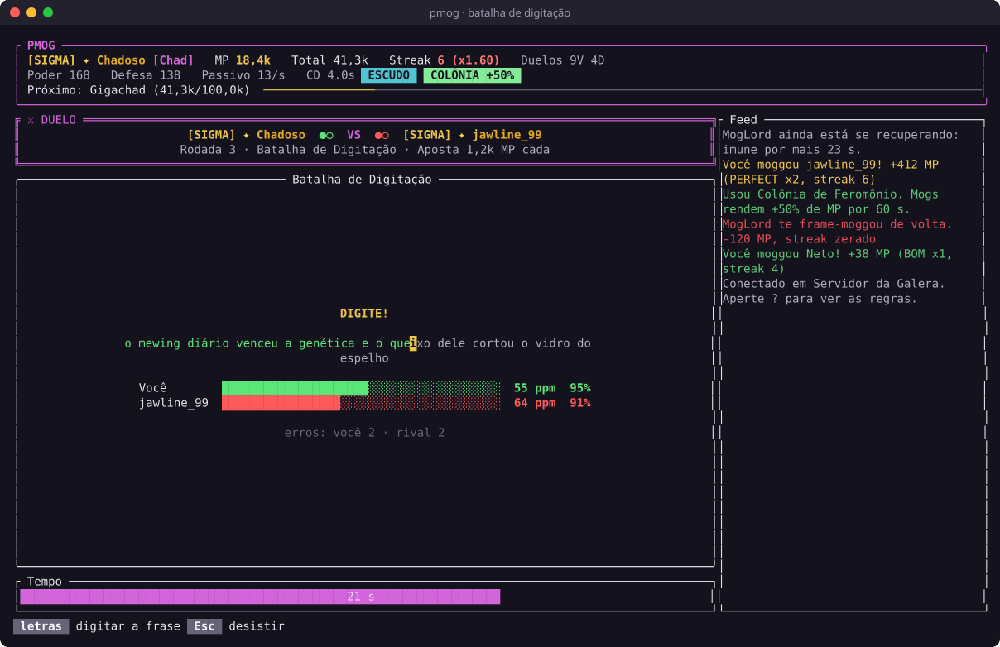

<div align="center">

# PMOG

**parses mogging** · a arena de mog da sua rede

Jogo de terminal multiplayer para a rede local. Um amigo hospeda, o resto entra pela lista, e todo mundo se mogga.


</div>

## O que tem

|  |  |
|---|---|
| **Mog com timing**: aperte ESPAÇO na hora certa do medidor. PERFECT rende o dobro. | **18 minigames de duelo**: cada um escolhe 3 dos 6 da partida, de encarada e digitação a fit check, fotogenia e mog reverso. |
| **34 itens na loja**, cada um com pixel art própria. | **Ranks de Sub-5 a Ascendido**, com nome que brilha, pega fogo e vira arco-íris. |
| **Chat, grupos e clãs**, com tag ao lado do nome e sem fogo amigo. | **Atualização automática** pela rede, só com builds assinadas. |

<table>
  <tr>
    <td></td>
    <td></td>
  </tr>
  <tr>
    <td></td>
    <td></td>
  </tr>
</table>

## Jogar

1. Baixe o executável do seu sistema (`pmog-linux` ou `pmog-windows.exe`) com quem já tem o jogo.
2. Abra no terminal. No Linux: `chmod +x pmog-linux && ./pmog-linux`.
3. Escolha **Hospedar servidor** ou entre num servidor da lista.
4. Aperte `?` dentro do jogo para ver todas as regras.

| Tecla | Ação | Tecla | Ação |
|---|---|---|---|
| `ESPAÇO` | mogar | `D` / `F` | duelo direto / fila |
| `↑ ↓` | trocar de alvo | `T` | chat |
| `M` | mewar | `G` | clã |
| `L` | loja | `1`–`8` | consumíveis |
| `C` | conquistas | `S` | painel do servidor |
| `?` | ajuda | `Q` | sair |

## Rede

Quem hospeda precisa liberar as portas (exemplo no Fedora):

```bash
sudo firewall-cmd --add-port=47790-47799/tcp --add-port=47777/udp
```

A descoberta usa UDP `47777` (multicast `239.77.77.77` e broadcast) e o jogo usa TCP na primeira porta livre entre `47790` e `47799`. Quem só entra precisa receber UDP `47777` para ver a lista. No Windows, permita o PMOG quando o firewall perguntar.

## Desenvolver

```bash
cargo run --release                 # abre o jogo
cargo test --release                # regras, duelos, rede real, stress e TUI
./scripts/bots.sh 4                 # 4 bots entram no primeiro servidor da rede
./scripts/build-dist.sh             # gera e assina dist/pmog-linux e dist/pmog-windows.exe
cargo run --example screenshots     # refaz as imagens deste README
```

<details>
<summary><b>Como funciona por dentro</b></summary>

- **Servidor autoritativo**: quem hospeda roda o servidor dentro do próprio jogo. Ele decide duelos, compras, cooldowns e o medidor; o cliente só manda ações.
- **Progresso no servidor**: SQLite em `~/.local/share/pmog/server.db` de quem hospeda. Trocar de servidor é começar outro progresso.
- **Identidade é o computador**: hash do UUID de hardware e do serial da placa (no Linux, pede a senha uma vez via `pkexec`; no Windows, PowerShell ou o MachineGuid do registro). Só o hash fica guardado. Trocar de nome mantém o progresso.
- **Mesma máquina, duas janelas**: a mais nova assume. Para testar com vários jogadores num PC só, use os bots.
- **Vindo do Mogger**: a pasta antiga `~/.local/share/mogger` é movida para `~/.local/share/pmog` na primeira vez.

</details>

<details>
<summary><b>Duelos e jogo limpo</b></summary>

- `D` desafia, `F` entra na fila (até 1 rank de distância; depois de 10 s, qualquer um). Aposta de amistoso a tudo do MP do mais pobre; as duas ficam presas no servidor e o vencedor leva. Empate ou servidor desligado devolve; sair no meio é desistência.
- 6 rodadas: antes de começar, cada um escolhe 3 minigames, alternando (ou pede um aleatório). Acaba antes se a vantagem não puder mais ser tirada; 3 x 3 vai para morte súbita com um minigame que ainda não saiu.
- 5 s de explicação antes de cada rodada e 3,5 s de pausa entre elas.
- Lag não conta: o servidor mede o ping e aceita o horário em que você apertou, dentro da janela que o ping permite.
- Mog entre jogadores só troca MP de mão. Bater em quem está 2 ranks abaixo rende 25%; 3 ou mais, nada.
- Quem apanha seguido fica imune por mais tempo (5 s, 15 s, 45 s, até 60 s). O tempo restante aparece ao lado do nome, e tentar mogar alguém imune não gasta cooldown.

</details>

<details>
<summary><b>Social</b></summary>

- **Chat (`T`)**: geral, privado, grupos e canal do clã, com histórico no servidor e mensagens entregues a quem estava offline.
- **Clãs (`G`)**: tag única ao lado do nome, convites, liderança e ranking por MP total. Membros do mesmo clã não se mogam nem apostam entre si.
- **Notificações**: só com o terminal fora de foco, agrupadas. Liga e desliga com `B` no painel do servidor.

</details>

<details>
<summary><b>Atualização automática e segurança</b></summary>

Quem hospeda com a versão nova oferece o executável para quem entra com a velha. O jogo pergunta antes, baixa, confere e reabre sozinho (`U` na tela inicial pergunta de novo).

- Cada build é assinada com Ed25519. A chave privada fica em `~/.config/pmog-release/release.key` e nunca sai do computador de quem publica; a pública (`release-pubkey.txt`) vai embutida em todo executável.
- A assinatura cobre plataforma, número da build, tamanho e SHA-256. Um host malicioso não consegue trocar os bytes, mudar a plataforma, fazer downgrade nem assinar nada próprio.
- Tudo é conferido com o arquivo ainda na memória; nada é gravado se falhar. O download tem limite de 64 MB e de tempo.
- Builds de desenvolvimento (`cargo run`) nunca atualizam nem oferecem atualização.
- Quem atualizou guarda o `.sig` ao lado do executável e passa a oferecer a mesma build quando hospeda.

**Publicar uma versão**: `./scripts/build-dist.sh`, depois hospede rodando `dist/pmog-linux` (o host oferece as duas plataformas da mesma pasta). `cargo run --example release -- check dist` mostra o que será oferecido.

</details>

<details>
<summary><b>Simulação e testes de carga</b></summary>

```bash
cargo run --release --example sim -- 8 120          # 8 bots, 120 min de jogo em segundos: invariantes, economia, duelos
cargo run --release --example latency -- 300 25 10  # justiça com lag, com e sem compensação
cargo run --release --example live -- 10 180 /tmp/live.db   # servidor real + 10 bots, falhas injetadas, auditoria do banco
```

</details>
