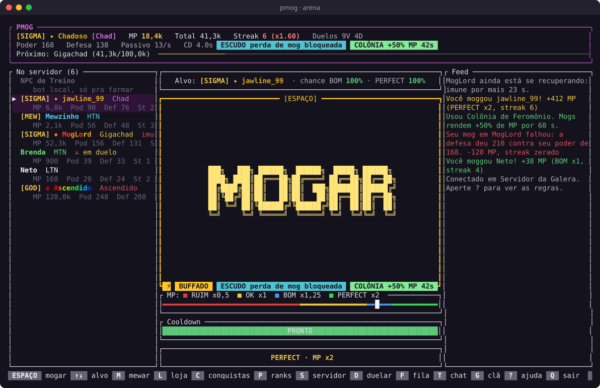
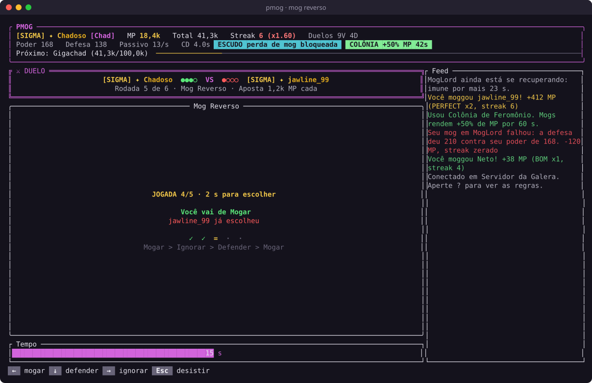
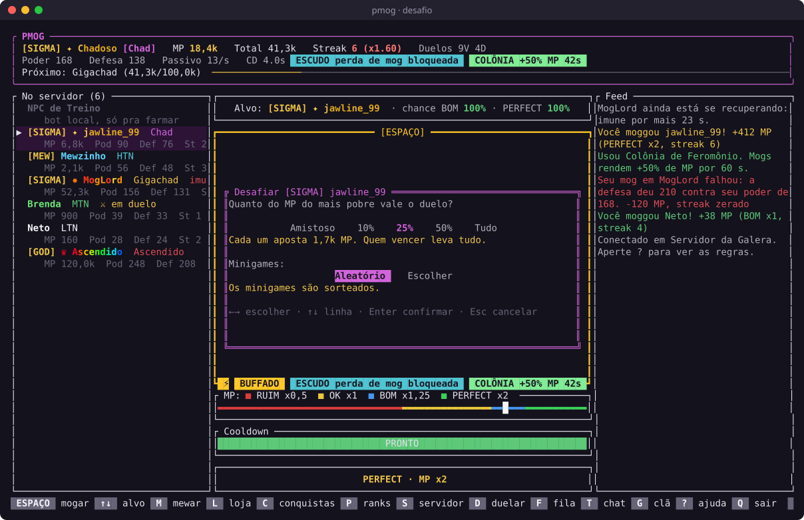
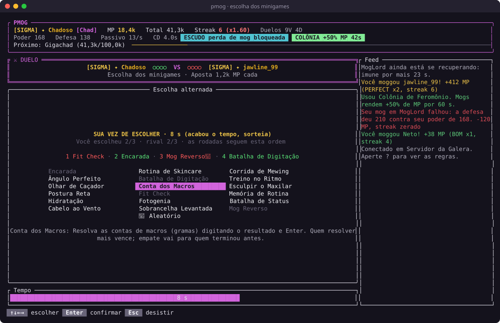
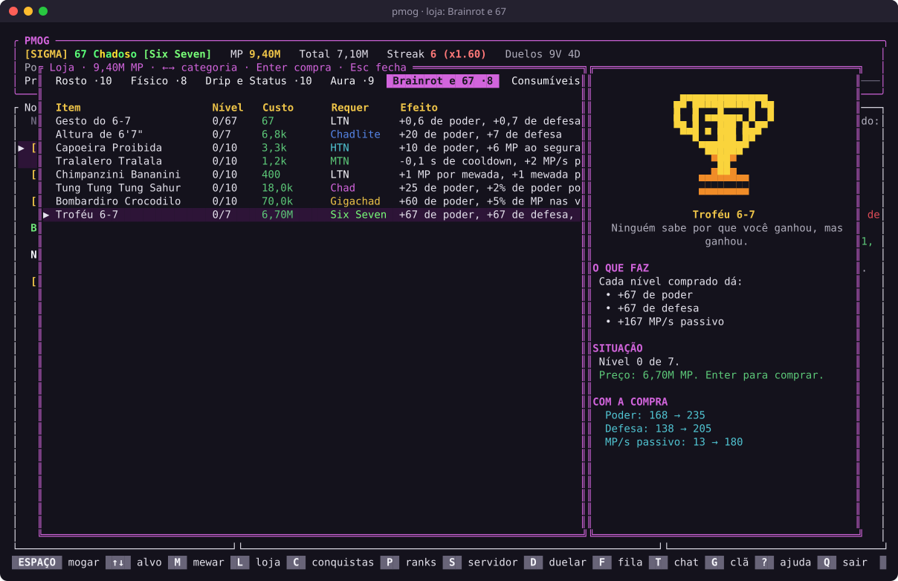
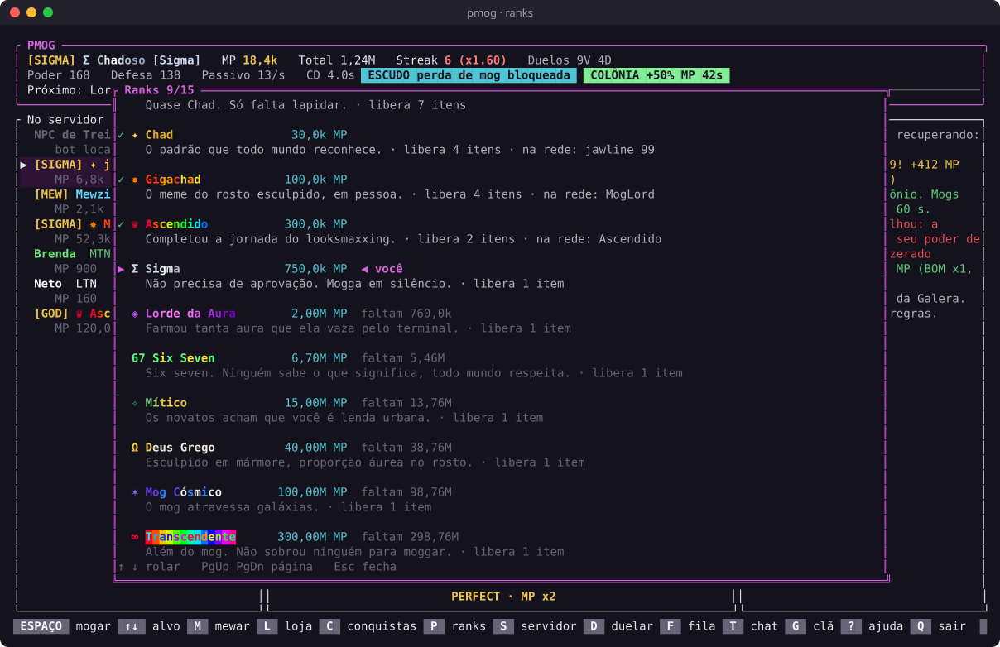
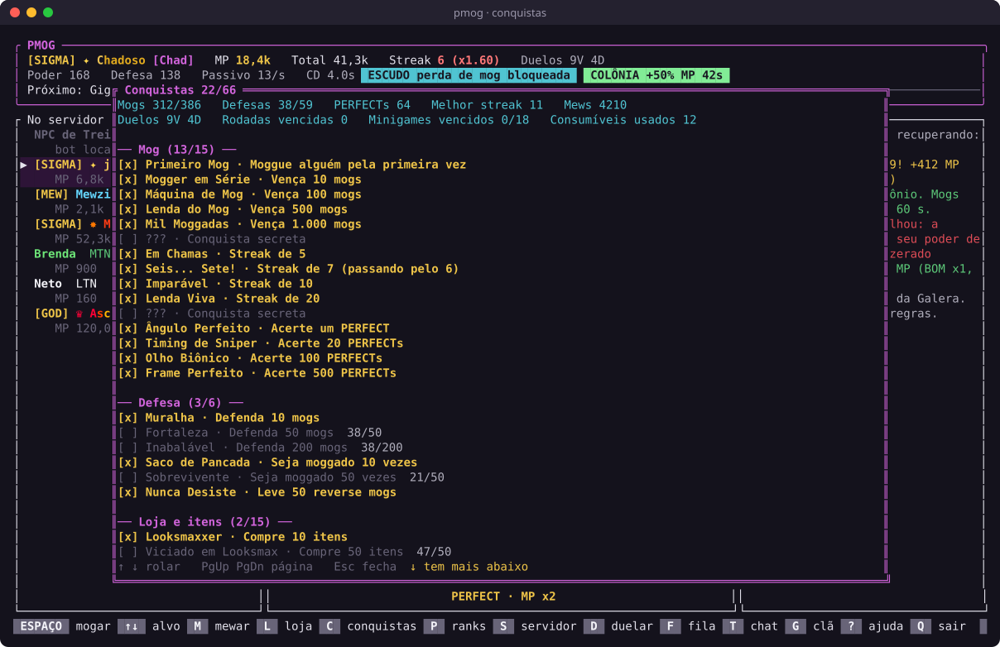
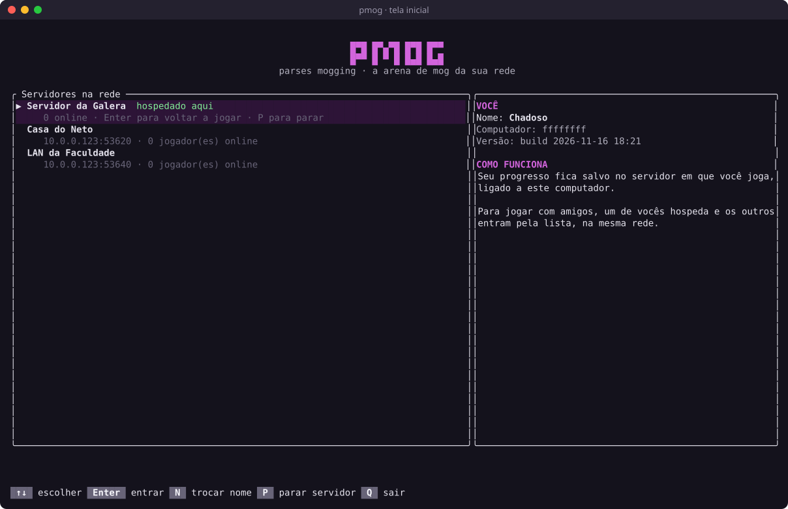
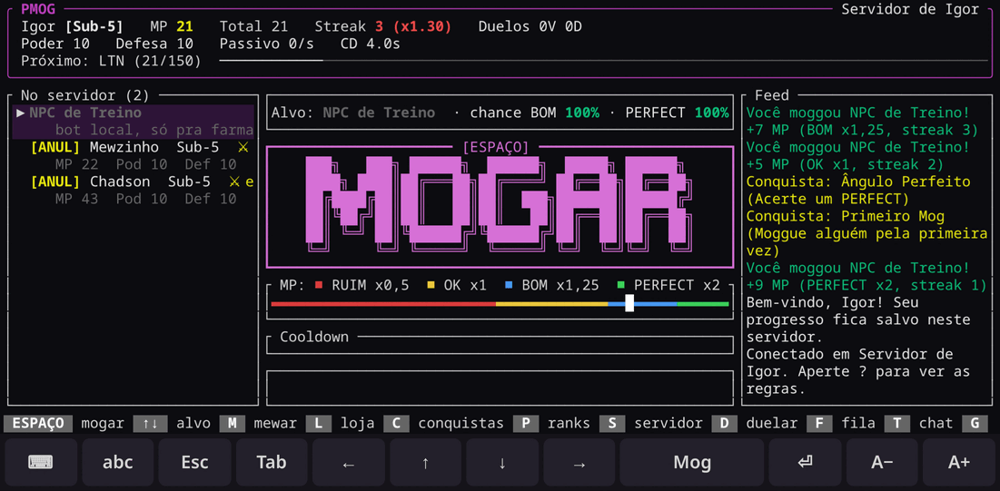

<div align="center">

# PMOG

**parses mogging** · a arena de mog da sua rede

Jogo de terminal multiplayer para a rede local. Um amigo hospeda, o resto entra pela lista, e todo mundo se mogga.




</div>

## O que tem

|  |  |
|---|---|
| **Mog com timing**: aperte ESPAÇO na hora certa do medidor. PERFECT rende o dobro, e o streak multiplica tudo. | **18 minigames de duelo** em 6 rodadas sorteadas, de encarada e digitação a fit check, fotogenia e mog reverso. Se os dois quiserem, cada um escolhe 3. |
| **59 itens na loja** em 6 abas (Rosto, Físico, Drip e Status, Aura, Brainrot e 67, Consumíveis), cada um com pixel art própria. Os 10 consumíveis ficam nas teclas `1`–`0`. | **Buffs à vista**: escudo, colônia, combo 6-7, aura farmada e afins aparecem numa faixa ⚡ BUFFADO enquanto valem. |
| **15 ranks**, de Sub-5 a Transcendente, cada um com um efeito no nome (brilho, fogo, arco-íris, estrelas, 6-7 piscando). Os 7 ranks acima do Ascendido liberam um item exclusivo cada. | **66 conquistas** em 7 grupos, com progresso (37/100) e 4 secretas. |
| **Chat, grupos e clãs**, com tag ao lado do nome e sem fogo amigo. **Atualização automática** pela rede, só com builds assinadas. | **Jogue no celular** pelo navegador: cada PMOG aberto vira acessível por um celular, com senha, espelhando ou assumindo a sua sessão. Botões na tela. |

<table>
  <tr>
    <td></td>
    <td></td>
  </tr>
  <tr>
    <td></td>
    <td></td>
  </tr>
  <tr>
    <td></td>
    <td></td>
  </tr>
  <tr>
    <td></td>
    <td></td>
  </tr>
  <tr>
    <td></td>
    <td></td>
  </tr>
</table>

### Ranks e itens exclusivos

| Rank | MP Total | Item exclusivo |
|---|---|---|
| Σ Sigma | 750 mil | Capuz do Lobo Solitário |
| ◈ Lorde da Aura | 2 milhões | Cetro da Aura |
| 67 Six Seven | 6,7 milhões | Troféu 6-7 |
| ✧ Mítico | 15 milhões | Pena de Fênix |
| Ω Deus Grego | 40 milhões | Busto de Mármore |
| ✶ Mog Cósmico | 100 milhões | Meteoro de Bolso |
| ∞ Transcendente | 300 milhões | Terceiro Olho |

## Jogar

1. Instale pelo seu sistema (página [Releases](https://github.com/Parsec-Inc/pmog/releases)):

   | Sistema | Como |
   |---|---|
   | Fedora / openSUSE | `sudo dnf install ./pmog-*.rpm` (ou pelo COPR, quando ligado) |
   | Debian / Ubuntu | `sudo apt install ./pmog_*.deb` |
   | Arch | `yay -S pmog-bin` (quando ligado) |
   | Windows | `pmog-X.Y.Z-x86_64.msi` |
   | macOS | `brew install Parsec-Inc/tap/pmog` (quando ligado) ou o `.tar.gz` |
   | Qualquer um | `pmog-linux` / `pmog-windows.exe` direto, ou com quem já tem o jogo |

2. Abra no terminal (`pmog`). Sem pacote, no Linux: `chmod +x pmog-linux && ./pmog-linux`.
3. Escolha **Criar mundo novo** (ou um mundo salvo) para hospedar, ou entre num servidor da lista. Dá para hospedar vários mundos ao mesmo tempo. Se o servidor não aparecer, aperte `I` e digite o IP (ou abra com `pmog --server IP`).
4. Aperte `?` dentro do jogo para ver todas as regras.

### No celular

Cada PMOG aberto no PC pode ser jogado de **um** celular por vez, na mesma rede, sem instalar nada:

1. No PC, aperte `C` (na tela inicial ou no painel `S`) e crie a senha do celular.
2. Abra no navegador do celular o endereço que aparece, algo como `http://192.168.0.10:47800`, ou leia o QR code do painel `S`.
3. Digite a senha. O navegador fica lembrado até a senha mudar.

`E` troca o modo: **espelho** (PC e celular controlam a mesma sessão) ou **assume** (o PC só assiste e `R` retoma). `X` desconecta o celular. A página é a própria tela do PMOG desenhada no tamanho do celular, então está sempre na mesma versão. Tem botões para setas, `Esc`, `Tab`, `Enter` e mog; `abc` mostra os atalhos e `⌨` abre o teclado (para chat e nome). De lado fica melhor.



| Tecla | Ação | Tecla | Ação |
|---|---|---|---|
| `ESPAÇO` | mogar | `D` / `F` | duelo direto / fila |
| `↑ ↓` | trocar de alvo | `T` | chat |
| `M` | mewar | `G` | clã |
| `L` | loja | `1`–`9`, `0` | consumíveis |
| `C` | conquistas | `S` | painel do servidor |
| `P` | lista de ranks | `?` | ajuda |
| `I` | inventário por aba | `O` | esconder/mostrar o inventário |
| `Q` | sair |  |  |

## Rede

O pmog não mexe no seu firewall: quem decide é você. Os pacotes de Linux trazem o serviço `pmog`
do firewalld e o perfil `pmog` do ufw, então liberar é um comando:

```bash
sudo firewall-cmd --permanent --add-service=pmog && sudo firewall-cmd --reload   # firewalld
sudo ufw allow pmog                                                               # ufw
```

Sem pacote, libere as portas à mão (ex.: `sudo firewall-cmd --add-port=47790-47809/tcp --add-port=47777/udp`).

A descoberta usa UDP `47777` (multicast `239.77.77.77` e broadcast) e o jogo usa TCP na primeira porta livre entre `47790` e `47799`. Quem só entra precisa receber UDP `47777` para ver a lista. Para jogar pelo celular, cada PC abre também a primeira porta TCP livre entre `47800` e `47809`. No Windows, permita o PMOG quando o firewall perguntar.

O servidor anuncia em todas as redes do computador (Wi-Fi, cabo e VPNs como o ZeroTier), e o painel do servidor (`S`) lista todos os endereços. Com amigos longe, coloque todo mundo na mesma rede virtual: o servidor aparece na lista como se fosse a rede local, e o mesmo servidor ouvido por duas redes aparece uma vez só. Em VPNs que não repassam broadcast, como o Tailscale, entre com `I` e o IP da VPN.

Ao abrir, o pmog confere o firewall (firewalld, ufw, Firewall do Windows ou do macOS) e, se achar algo bloqueando, mostra na tela inicial o comando para liberar. Quando um servidor aparece na lista mas não responde, o aviso lembra que o firewall de um dos lados pode ser o motivo.

## Desenvolver

```bash
cargo run --release                 # abre o jogo
cargo test --release                # regras, duelos, rede real, stress e TUI
./scripts/bots.sh 4                 # 4 bots entram no primeiro servidor da rede
./scripts/build-dist.sh             # gera e assina dist/pmog-linux e dist/pmog-windows.exe
./scripts/package.sh deb rpm        # pacotes a partir do dist/ (ver docs/PACKAGING.md)
cargo run --example screenshots     # refaz as imagens deste README
```

<details>
<summary><b>Como funciona por dentro</b></summary>

- **Servidor autoritativo**: quem hospeda roda o servidor dentro do próprio jogo. Ele decide duelos, compras, cooldowns e o medidor; o cliente só manda ações.
- **Progresso no mundo**: cada mundo é um SQLite em `~/.local/share/pmog/worlds/` de quem hospeda, com o nome guardado dentro do próprio banco; cada mundo hospedado é um servidor numa porta própria. Trocar de mundo é começar outro progresso. Apagar manda o arquivo para `~/.local/share/pmog/lixeira/`, e o `server.db` de versões antigas vira o primeiro mundo sozinho.
- **Identidade é o computador**: hash do UUID de hardware e do serial da placa (no Linux, pede a senha uma vez via `pkexec`; no Windows, PowerShell ou o MachineGuid do registro). Só o hash fica guardado. Trocar de nome mantém o progresso.
- **Celular**: cada PMOG escuta HTTP numa porta própria. `/` entrega uma página (canvas + botões) e `/ws` abre um WebSocket. A mesma sessão é desenhada uma segunda vez no tamanho da tela do celular e só as linhas que mudaram vão pela rede; as teclas do celular entram como se fossem do PC. A senha fica só como hash com sal na config local, cada navegador guarda um token aleatório que vira confiável depois da senha certa, e 5 erros seguidos fecham a porta por 60 s.
- **Mesma máquina, duas janelas**: a mais nova assume. Para testar com vários jogadores num PC só, use os bots.
- **Vindo do Mogger**: a pasta antiga `~/.local/share/mogger` é movida para `~/.local/share/pmog` na primeira vez.

</details>

<details>
<summary><b>Duelos e jogo limpo</b></summary>

- `D` desafia, `F` entra na fila (até 1 rank de distância; depois de 10 s, qualquer um). Aposta de amistoso a tudo do MP do mais pobre; as duas ficam presas no servidor e o vencedor leva. Empate ou servidor desligado devolve; sair no meio é desistência.
- 6 rodadas com minigames sorteados, sem repetir. Opcional: no seletor de aposta, desça (`↓`) para a linha Minigames e marque Escolher; cada um pega 3, alternando, com 12 s por escolha (na fila, só se os dois marcarem). Acaba antes se a vantagem não puder mais ser tirada; 3 x 3 vai para morte súbita com um minigame que ainda não saiu.
- 5 s de explicação antes de cada rodada e 3,5 s de pausa entre elas.
- Lag não conta: o servidor mede o ping e aceita o horário em que você apertou, dentro da janela que o ping permite.
- Mog entre jogadores só troca MP de mão. Bater em quem está 2 ranks abaixo rende 25%; 3 ou mais, nada. Bater em quem está acima rende até 3x, e quem está acima perde até 3x quando falha contra um rank menor.
- Status de luta: crítico deixa **Abalado** (defesa -25% por 20 s). Rank menor que vence um maior ganha **Ego Proibido** (poder +15%, +25% ou +40% por 30 s, conforme a diferença) e o maior fica com **Perdeu Aura** (o mesmo, para baixo), que não volta antes de 30 s depois de acabar. A Sessão de Terapia encurta os status ruins. A chance mostrada ao lado do alvo já conta os status dos dois.
- Quem apanha seguido fica imune por mais tempo (5 s, 15 s, 45 s, até 60 s). O tempo restante aparece ao lado do nome, e tentar mogar alguém imune não gasta cooldown.

</details>

<details>
<summary><b>Social</b></summary>

- **Chat (`T`)**: geral, privado, grupos e canal do clã, com histórico no servidor e mensagens entregues a quem estava offline.
- **Clãs (`G`)**: tag única ao lado do nome, convites, liderança e ranking por MP total. Membros do mesmo clã não se mogam nem apostam entre si.
- **Notificações**: só com o terminal fora de foco, agrupadas. Liga e desliga com `B` no painel do servidor.

</details>

<details>
<summary><b>Atualização automática e segurança</b></summary>

Quem hospeda com a versão nova oferece o executável para quem entra com a velha, e ao abrir o jogo também procura a última versão nas [releases do GitHub](https://github.com/Parsec-Inc/pmog/releases) (com o `curl` do sistema, sem login). O jogo pergunta antes, baixa, confere e reabre sozinho (`U` na tela inicial pergunta de novo ou procura no GitHub).

- A release do GitHub é tratada como um host qualquer: vale só o `.sig` assinado, não o site.
- Cada build é assinada com Ed25519. A chave privada fica em `~/.config/pmog-release/release.key` e nunca sai do computador de quem publica; a pública (`release-pubkey.txt`) vai embutida em todo executável.
- A assinatura cobre plataforma, número da build, tamanho e SHA-256. Um host malicioso não consegue trocar os bytes, mudar a plataforma, fazer downgrade nem assinar nada próprio.
- Tudo é conferido com o arquivo ainda na memória; nada é gravado se falhar. O download tem limite de 64 MB e de tempo.
- Builds de desenvolvimento (`cargo run`) nunca atualizam nem oferecem atualização.
- Quem atualizou guarda o `.sig` ao lado do executável e passa a oferecer a mesma build quando hospeda.

**Publicar uma versão**: `./scripts/build-dist.sh`, depois hospede rodando `dist/pmog-linux` (o host oferece as duas plataformas da mesma pasta). `cargo run --example release -- check dist` mostra o que será oferecido.

</details>

<details>
<summary><b>Simulação e testes de carga</b></summary>

```bash
cargo run --release --example sim -- 8 120          # 8 bots, 120 min de jogo em segundos: invariantes, economia, duelos
cargo run --release --example latency -- 300 25 10  # justiça com lag, com e sem compensação
cargo run --release --example live -- 10 180 /tmp/live.db   # servidor real + 10 bots, falhas injetadas, auditoria do banco
```

</details>
